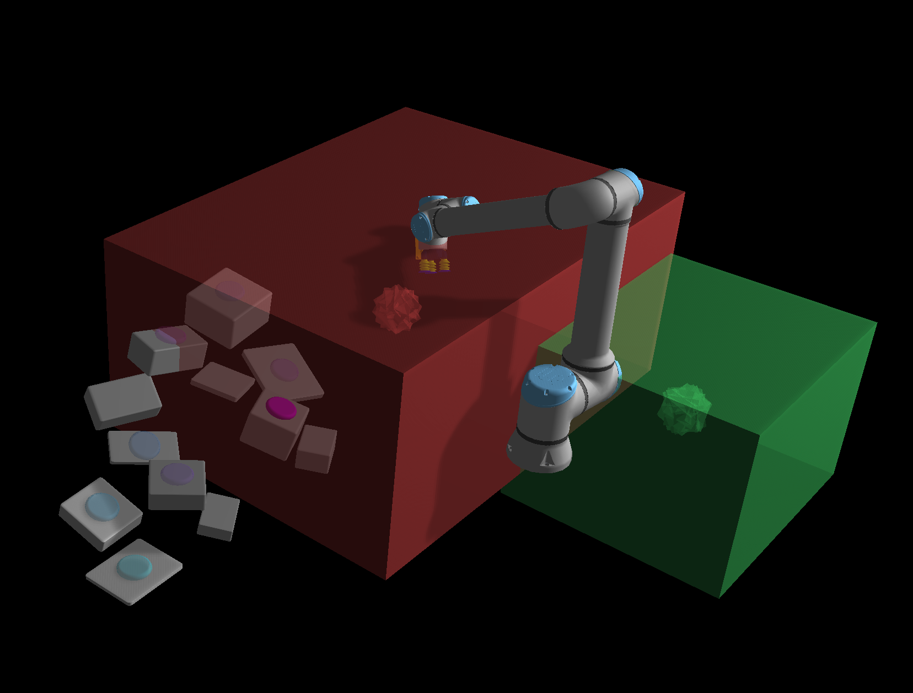
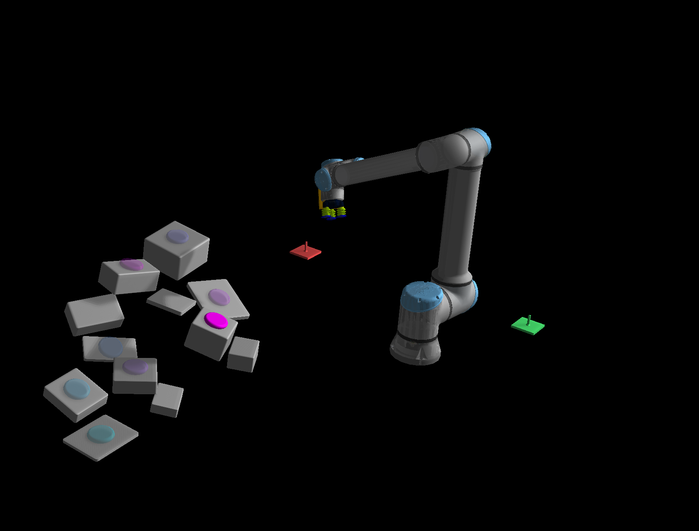
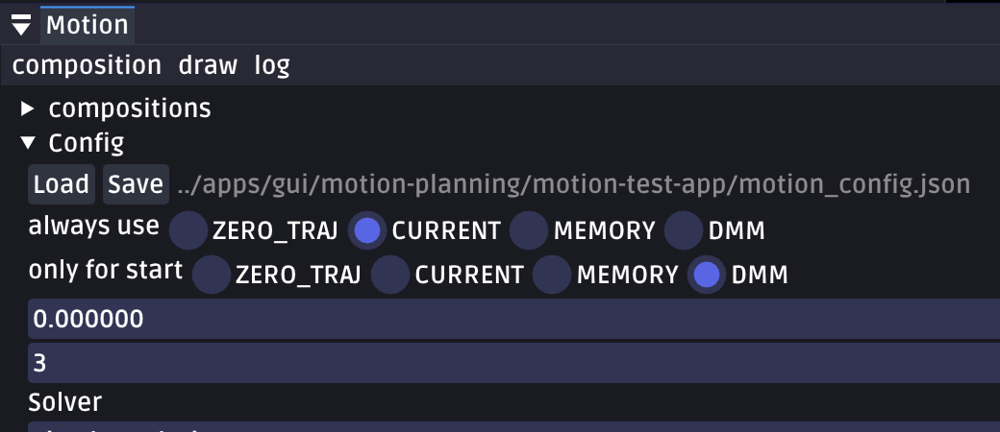
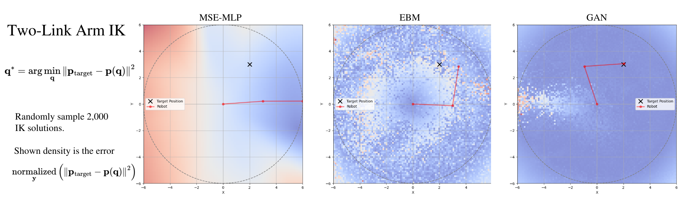
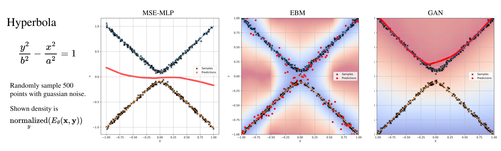

# Deep Manipulation Memory

## Installation

To install the necessary dependencies, follow these steps:

1. Clone the repository:
    ```sh
    git clone git@github.com:flink-robotics/dmm.git
    cd dmm
    ```

2. Install the required packages:
    ```sh
    pip install -r requirements.txt
    ```

## Data Collection Pipeline

### Step 1: Create DMM Specification

Specify the inputs and sampling space using the `dmm-setup-app` and save the specification as `dmm_specification.json`.

For the Swiss Post Singulation Task, the inputs are: box pick pose, box drop pose, and robot start configuration. The specification includes the initial seed and sampling domain of the inputs. All can be set up and visualized in `dmm-setup-app`.

<p align="center">
  
  
  <br>
  The boxes show the range of positions, and the center boxes show the orientation range. Red indicates the picking pose, and green indicates the dropping pose.
</p>


### Step 2: Generate Solutions

1. Move the `dmm_specification.json` file to `/flink/cerebo/tui/motion-generation`.
2. Set the hyperparameter exploration step size: 

start

.
3. Set `mode` to `"train"` for collecting training data and `"test"` for testing data.
4. Run `motion-generation-2` to generate trajectories saved as `single_task_sols_{step_size}.json` under `./data`.

The `motion-generation-2` app uses incremental sampling to explore the input space in a manner similar to Rapidly-exploring Random Tree (RRT). It stores a tree structure and uses the solution of a close neighbor as a seed to initialize the optimization. This approach maintains a single mode of behavior, which is important for vanilla behavior cloning.

The `motion-generation-dmm` app uses DMM to initialize the optimization. This can be applied in a loop to iteratively improve data quality and DMM performance. First, use `motion-generation-2` to generate initial data, train a DMM, and then use `motion-generation-dmm` to collect more data for training.

---

## Train DMM

### Step 1: Data Filtering

Create a data folder under `dmm` and move the collected `single_task_sols_{step_size}.json` files to it. Then run:
```sh
python data_process.py -f data
```

This will filter the data based on the Euler distance of the trajectories, remove outliers, and save the filtered data as `X_filtered.trc` and `Y_filtered.trc`.


### Step 2: Model Training

Run the following commands to train different models for the Deep Manipulation Memory (DMM):

- **MSE-MLP based DMM**: Works great with single mode data.
    ```sh
    python train_mlp.py
    ```

- **Temporal UNet based DMM**: Suitable for multi-modality data.
    ```sh
    python train_cgan.py
    ```

- **CVAE based DMM**: Not recommended as it does not work.
    ```sh
    python train_cvae.py
    ```

The training process and the model are saved under `./logs/{model}_{time:%Y_%m_%d_%H_%M_%S}`.

## Test and Deployment

The model should be placed under `APP_FOLDER "/flink-networks/dmm/"`.

For testing, move the ONNX model to `/flink/cerebo/gui/motion-planning/motion-test-app` and modify the corresponding `filenames_dmm`.

Run `motion-test-app`. Choose to use DMM as warm start method under the `Motion` Modular.

<p align="center">
  
</p>

Similar steps apply for other applications such as `singulation-app`.


## Finial Thoughts


### Multi-modality data

The major difficulty in training DMM lies in the multi-modality of the data, or in other terms, the conflicting data points, where inputs are similar but outputs vary significantly. Direct supervised learning with loss functions such as MSE tends to average the outputs, resulting in poor performance.


<p align="center">
  
  <br>
  Two-Link_IK: the background shows the error. MSE fails. EBMs generally works but with high error. GAN has the best performance.
</p>

<p align="center">
  
  <br>
  Two-valued hyperbola: The MSE-based MLP averages modes (red), EBMs capture both but generate suboptimal samples, GANs captures one mode out of the mixed data.
</p>

For robot manipulation, this problem is bound to happen since there exist multiple solutions for a given task.


### Solutions


